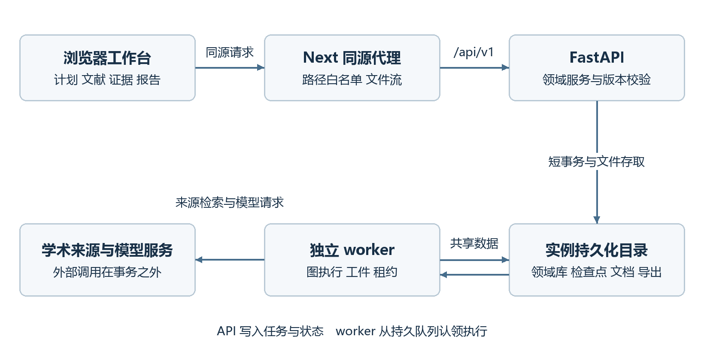
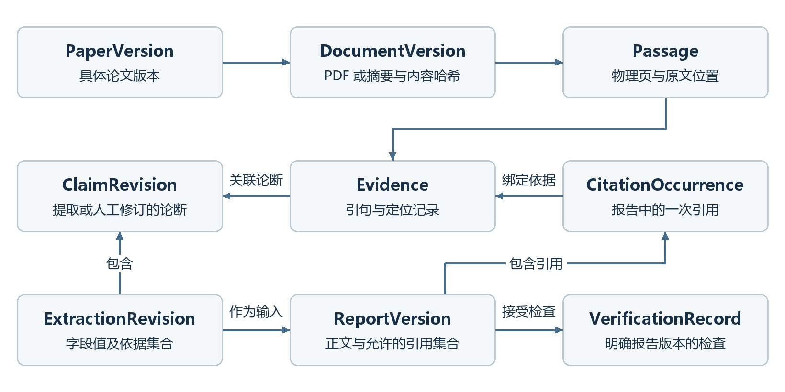

# ScholarFlow 项目讲解与面试手册

多智能体科研文献研究与报告生成平台

版本 v0.1　整理日期 2026 年 10 月 15 日

代码基线 794e97be　仓库 https://github.com/yibenwulong/ScholarFlow

本手册面向准备介绍 ScholarFlow 的开发者，覆盖项目速通、简历表述、模块讲解、技术追问、源码导读和演示验收。阅读目标是能够把研究场景、工程问题、实现选择和验证证据连在一起，遇到追问时能回到代码解释。

项目基于 GPT Researcher 改造。新增工作台位于 `/projects`，后端新接口位于 `/api/v1`。当前版本面向本地或可信环境中的单用户使用，采用一个独立 worker 执行持久化研究任务。项目的工程验证记录与真实科研质量评价分别说明。

## 第一章 文档说明与项目资料

### 1 阅读方法

建议先运行无密钥演示，再按模块阅读源码。一次完整演示应看见计划审批、显式纳入文献、原文证据、报告编辑与草稿导出，而不只是一个“生成成功”的页面。只有操作过这些环节，面试讲解才能回答“这个约束在哪里生效”和“错误发生时用户看到什么”。

本手册沿用项目面试资料中“项目概览、简历职责、模块讲解、相关知识、实现笔记、常见问答”的组织方式。模块表达按照背景、问题、方案和复盘展开。表达示例用于练习，应根据实际参与范围和理解程度调整，不应把项目现有功能全部写成个人独立完成的职责。

阅读时先建立三条主线。第一条是业务线，从研究问题走到可审阅的报告。第二条是数据线，从论文身份走到具体文档、原文和引用。第三条是执行线，解释任务如何排队、暂停、恢复以及拒绝旧执行的结果。三条线能在一处引用或一个 Run 上交汇，就能讲清这个项目。

### 2 项目定位

研究生和科研人员开展文献调研时，需要处理检索词不一致、同一论文多版本、全文获取受限、不同论文评价口径不同等问题。把若干网页交给模型总结，只能得到文字，难以回答某句话来自哪篇论文、哪一版文件和哪段原文。

ScholarFlow 把人工确认、文献来源、提取结果、报告引用和检查记录组织成持久化工作流。模型承担计划、筛选建议、阅读、综合和支持性判断；检索适配器、文件解析、任务调度和版本校验由确定性代码完成。人工负责批准研究范围、确认纳入集合和审阅结果。

当前项目支持主题综述与方法比较。它能帮助组织文献和生成待审阅稿件，不提供系统综述穷尽检索保证，也不把模型核验结果当成科学事实认证。没有开展真实来源召回率、模型准确率或节省时间的测量。

### 3 技术栈与系统组成

| 层次 | 当前采用的技术 | 在项目中的作用 |
| --- | --- | --- |
| 前端 | Next.js 14 React 18 TypeScript | 项目工作台、矩阵、原文查看、报告编辑与同源代理 |
| API | FastAPI Pydantic | 领域接口、参数校验、版本冲突和文件下载 |
| 工作流 | LangGraph | 状态图、人工中断、恢复与节点衔接 |
| 执行器 | Python asyncio TaskGroup | 独立 worker、逐篇任务与受限并发 |
| 持久化 | SQLite 与 SQLite checkpoint | 领域对象、任务、事件、调用审计及图检查点 |
| 文档处理 | PyMuPDF python-docx | PDF 文本与物理页提取、DOCX 导出 |
| 学术来源 | arXiv Semantic Scholar OpenAlex | 元数据、摘要和可用全文地址 |
| 验证 | pytest Playwright | 领域、API、恢复、桌面与移动端完整流程 |



图 1　浏览器通过 Next 同源代理访问 API，API 与独立 worker 共享持久化数据。

这里的“多智能体”指同一研究图中的六种职责，不表示运行了六个不同模型或六个常驻服务。Retriever 主要执行确定性的来源适配器。系统使用的具体模型配置在服务端，可由多个角色复用。

### 4 已有成果与表述范围

仓库在 2026 年 10 月 15 日的验证记录包括 108 项 ScholarFlow 后端测试、37 项相关旧功能回归、34 项使用模拟 API 的浏览器测试，以及 2 项通过真实 API 和独立 worker 的合成数据浏览器流程。前端 lint、TypeScript 检查和生产构建均有通过记录。全仓 682 项测试完成了收集，这不能表述为 682 项全部执行通过。

真实链路测试仍使用自建文献、PDF 和固定模型响应。它证明代理、API、任务执行与导出能够协同工作，不能证明真实科研报告质量。本机没有执行 Docker 镜像构建和容器启动；配置文件存在、YAML 可解析和容器真正可用是不同证据。

项目没有线上用户量、QPS、可用性、真实召回率、准确率或成本下降比例。简历可以写有验证依据的功能与测试覆盖，不应填入参考项目中的性能数字。

主要资料入口为 `README-zh_CN.md`、`docs/scholarflow/architecture.md`、`docs/scholarflow/verification.md`、`docs/scholarflow/evaluation.md` 和 `UPSTREAM.md`。完整路径从仓库根目录开始；后端简写相对 `backend/scholarflow`，测试文件简写相对 `tests/scholarflow`，前端简写相对 `frontend/nextjs`。

## 第二章 项目速通与整体流程

### 1 先看懂一个研究任务

用户创建项目，给出研究问题、年份范围、来源和报告类型。Planner 生成包含检索式、纳排标准和子问题的结构化计划；当前页面允许编辑检索式与纳排标准，子问题随版本保留，没有单独编辑控件。计划只有在人工批准后，才能驱动后续检索。

Retriever 根据已批准的计划请求学术来源，保存候选、来源信息和检索覆盖。Screener 使用标题、摘要及该计划的标准给出建议。AI 建议和人工纳排是两个字段，模型不能直接把论文变为本次分析的正式输入。

用户勾选明确的论文版本子集，系统创建 SelectionSnapshot。未选中的候选可以继续处于 pending，不阻塞本次分析。接着系统准备 PDF 或摘要，Reader 并行提取字段并形成证据链，Writer 按这些输入生成报告，Verifier 逐处核验报告里的实际说法。

核验存在问题时，流程最多自动改写一次，再次检查后仍有问题就等待用户审阅。用户可编辑正文、保存新版本并发起独立复核，也可只读查看已有引用来源；不需要手动维护内部引用绑定。独立复核只检查该版本，不会改写正文或补齐关联，自动关联不完整时仍会待复核。用户也可接受明确版本与检查记录的问题草稿，再带着标记导出。

### 2 六种角色的职责

| 角色 | 输入与输出 | 不能替代的约束 |
| --- | --- | --- |
| Planner | 项目快照转为检索式、标准与子问题 | 不能自行批准计划 |
| Retriever | 已批准计划转为候选文献和检索覆盖 | 不能凭标题编造论文 |
| Screener | 文献元数据和计划转为筛选建议 | 不能覆盖人工决定 |
| Reader | 固定文档转为字段、Claim 和 Evidence | 不存在的内容应保持缺失 |
| Writer | 提取结果和允许引用集合转为报告 | 不能创造输入外的书目与证据 |
| Verifier | 每处论断及证据转为支持性记录 | 检查通过不等于科学真实性认证 |

实际图中还有计划审批、纳入确认、文档准备和结束节点，共十个主要节点。角色数量与图节点数量不必相等。图定义见 `backend/scholarflow/workflows/graph.py`，节点实现见 `workflows/nodes.py`。

### 3 两个人工确认点

第一次确认固定计划的具体修订。系统不会只存一个 approved 布尔值，再在执行时读取“最新计划”；Run 的 manifest 保存确切 PlanRevision ID。Run 在采用该已批准计划时，还会检查计划所属项目修订是否匹配研究任务快照。

第二次确认固定参与分析的 PaperVersion 集合。这样用户修改候选列表或切换某篇论文版本时，不会悄悄改变已经开始的研究任务。需要使用新的固定输入，应创建新的 Run，而不是重写旧 manifest。

这两个确认点分别控制研究范围和证据集合。它们不是模型输出后附加的界面提示，而是在后端服务和图中断处执行的输入条件。

### 4 无密钥演示启动

在仓库根目录创建并激活 Python 3.12 以上虚拟环境，安装依赖：

```powershell
python -m venv .venv
.venv\Scripts\Activate.ps1
python -m pip install -e ".[test,scholarflow]"
```

第一个终端运行演示 API 与独立 worker。这个脚本会明确启用合成模式，不请求真实学术服务或付费模型：

```powershell
python scripts/scholarflow_demo.py --port 8000
```

第二个终端使用 Node 22 以上环境运行前端：

```powershell
cd frontend/nextjs
npm ci
npm run dev
```

打开 `http://localhost:3000/projects`。先确认页面出现合成演示标签，再创建项目、生成并批准计划，选择两篇 Synthetic Graph Collaboration A 和 B。保留 Abstract-only 候选不选中，可以观察“只分析显式子集”的行为。

### 5 真实模式启动

复制 `.env.example` 为 `.env`，在服务端设置 `SCHOLARFLOW_MODEL=provider:model` 及对应密钥。当前新网关启用 OpenAI 兼容、Azure OpenAI、Anthropic、Ollama 适配；Anthropic 需要额外安装 `langchain-anthropic`。来源密钥与外部限流条件按实际服务配置。密钥不能放进浏览器环境或提交到 Git。

```powershell
Copy-Item .env.example .env
python -m uvicorn main:app --host 127.0.0.1 --port 8000
```

另开已激活虚拟环境的终端运行 worker，再启动前端。API 和 worker 必须使用相同的数据目录：

```powershell
python -m backend.scholarflow.worker
```

仅启动 API 不会自动完成研究任务。前端服务端代理通过 `SCHOLARFLOW_API_URL` 找到 API，默认地址为 `http://127.0.0.1:8000`。真实模式缺少配置时应处理错误，不会自动切成合成研究结果。

### 6 默认运行参数

| 参数 | 默认值 | 含义 |
| --- | --- | --- |
| 纳入论文数量 | 最多 20 篇 | 显式选择集合的规模限制 |
| 来源检索额度 | 每来源 20 条 | 多检索式共享该来源剩余额度 |
| 阅读并发 | 2 | artifact 执行器的并发配额 |
| 模型尝试预算 | 100 次 | 发送前占用，失败尝试也计入 |
| 文件大小 | 50 MiB | 上传和下载的大小限制 |
| PDF 页数 | 500 页 | 解析的页数限制 |
| 任务租约 | 60 秒 | worker 需要持续续约 |
| 心跳间隔 | 15 秒 | 后台续约频率 |
| 自动改写 | 最多 1 次 | 首轮核验后的一次自动修订 |

这些是代码默认值或固定策略，不是性能测试结果。可配置项从 `ScholarSettings` 读取；模型调用次数上限会进入 Run 快照。

## 第三章 简历中的项目撰写

### 1 项目名称与背景描述

推荐名称为“ScholarFlow 多智能体科研文献研究与报告生成平台”。项目背景可表述为：面向研究生文献调研场景，基于 GPT Researcher 改造，覆盖研究计划、学术检索、人工筛选、证据提取、报告综合、引用核验及版本化导出。

技术栈写实际使用且能够解释的部分，例如 Python、FastAPI、Pydantic、LangGraph、SQLite、PyMuPDF、Next.js、React、TypeScript、pytest 和 Playwright。不应因为上游仓库包含某个依赖，就把它写成新科研流程的核心设计。

### 2 后端方向的职责参考

以下四点是可选表述，应按本人实际负责范围采用动词和顺序。

- 基于 LangGraph 和 SQLite checkpoint 构建包含计划审批与纳入确认的人机协作工作流，冻结阶段输入并通过持久化任务恢复研究进度。
- 设计论文身份、论文版本、来源、文档、提取修订与报告版本的关联模型，采用请求幂等、revision CAS 和发布投影处理重复操作、并发修改与晚到结果。
- 建立 PDF 内容哈希、物理页码、原文字符位置与报告逐处引用的证据链，支持报告编辑后的版本保留、系统核验和问题草稿导出。
- 通过发送前调用预算、关闭已知 SDK 隐式重试、任务层重试和成功工件复用治理模型调用，并记录可获得的用量与请求信息。

后端方向建议重点准备“租约为什么还需要 generation”“审批为何绑定 revision”“保存记录和正式发布为何分开”三个追问。这些问题比罗列接口数量更能体现对失败场景的理解。

### 3 全栈方向的职责参考

- 建立项目、计划、文献、证据矩阵和报告工作台，通过同源代理统一访问科研 API，保留文件流与 PDF Range 请求。
- 采用服务端快照与本地编辑状态分离、expected_revision、按报告版本保存的临时草稿和保存期间编辑锁，处理轮询、并发编辑及版本切换。
- 实现报告引用及其已有关联来源的只读展示，保留正文编辑与版本保存，并展示修改后待核验、证据不足和草稿接受状态。
- 通过 seq 游标补读持久化事件，支持断线后的进度恢复；使用桌面与移动端浏览器用例验证主要操作。

全栈方向不能把“有 sessionStorage”说成云端自动保存，也不能把 HTTP 轮询说成 WebSocket 推送。应能说明浏览器刷新、两个标签页和保存响应延迟时各自的处理方式。

### 4 项目验证成果的写法

可写：“建立领域、API、任务恢复及桌面移动端验证，现有记录为 108 项后端测试、34 项模拟 API 浏览器测试、2 项真实 API 与独立 worker 的合成流程测试通过，前端生产构建通过。”

不应写“文献准确率达到某百分比”“检索召回率提升某百分比”“支持百万用户”“模型调用成本降低某百分比”。这些结论需要明确的数据集、基线、环境、口径与实测记录，当前项目没有相应证据。

### 5 一分钟项目介绍

“ScholarFlow 是一个基于 GPT Researcher 改造的科研文献研究平台，目标用户是研究生和科研人员。用户先提出研究问题，由模型生成检索计划，人工批准后再从学术来源收集候选，并明确确认本次分析的论文版本集合。

系统随后阅读固定的 PDF 或摘要，形成比较矩阵和原文证据，再综合生成报告。工程上重点处理了三类问题：长期任务怎样暂停与恢复，人工修改和文档版本怎样保持可追溯，以及报告每一处引用怎样回到确切论断与原文。当前版本是可信单用户工具，已经完成离线和合成数据的完整链路验证，真实科研质量还需要进一步评价。”

### 6 三分钟项目介绍

开头用约半分钟说明研究场景：论文存在多版本、全文未必可用，单纯生成带参考文献的文字不能保证引用支持当前论断。随后用约半分钟串起计划审批、显式纳入、阅读、写作、核验与导出。

用一分钟介绍自己最熟悉的一条工程主线。例如讲任务恢复：API 写入 Run 和 driver job，独立 worker 认领任务；图检查点负责流程位置，领域 manifest 固定已发布输入，artifact 保存已成功的逐篇结果；租约和 generation 拒绝被接管后的旧执行。这里要说明外部模型调用仍可能因崩溃重试而重复计费，不能承诺端到端 exactly-once。

再用半分钟讲一处具体问题与修复，例如保存请求期间继续输入会被新版本载入覆盖，因此锁定从请求开始延续到新版本正文加载完成。最后说明测试证据和适用边界，把话题引到能现场展示的代码或页面。

## 第四章 多智能体编排与人工决策

### 1 背景与问题

文献调研的前后步骤有依赖关系，且用户必须参与。若把整个流程写成一次长 HTTP 请求，计划未经确认就可能执行，浏览器超时后也难以知道完成到哪里。若只在内存中保存阶段状态，worker 重启会丢失等待位置和已完成成果。

另一个问题是用户在等待期间可能修改计划或论文集合。如果后续节点总是查询当前最新值，同一个 Run 的含义就会随时间变化，最后无法解释报告依据的是哪次审批。

### 2 当前方案

系统把研究过程定义为状态图：plan、approve_plan、search、screen、confirm_selection、documents、read、write、verify、finish。计划审批和纳入确认使用 interrupt，外部动作经 RunService 校验后继续。图状态由 AsyncSqliteSaver 持久化。

Run 创建时保存项目、模型和限制的快照，阶段结果通过 manifest 追加。计划 manifest 固定 PlanRevision ID，选择 manifest 固定 SelectionSnapshot 及论文版本 ID。`put_manifest` 不允许不同内容覆盖已经固定的同名阶段记录。

真正执行检索或阅读前还要检查后端条件，因此绕过前端按钮也不能随意跳过审批。人工决定是领域数据，不依赖模型在提示词里“自觉等待”。

### 3 为什么采用职责划分

Planner 的结构化结果是检索计划，Reader 的结果是字段与证据，Writer 的结果是报告段落与引用，Verifier 的结果是支持性记录。分开职责便于为各阶段设置输入、输出验证和错误恢复，不必让一次模型回答同时完成所有任务。

项目没有让六个自由代理任意互相调用工具。来源检索、持久化、纳排权限和状态迁移由程序控制。这种约束适合需要人工负责最终研究范围的场景，也更容易复现失败。

### 4 可直接练习的讲解

“这部分解决的是长任务和人工参与的问题。我没有把检索、阅读和写报告放在一次请求里，而是拆成带持久状态的图。计划和纳入集合有明确的人工中断；继续运行前，服务端检查用户批准的版本和 Run 快照是否匹配。

图检查点保存执行位置，Run manifest 则固定业务输入。两者职责不同。即便恢复时重新进入某个节点，也会先检查已经发布的阶段结果，避免把当前最新计划替换进旧研究。代价是修改固定输入要开新的 Run，但研究结果的来源更容易解释。”

### 5 面试追问

如果被问“为什么不用一个 for 循环”，可以回答：小型一次性脚本可以用顺序调用；本项目需要人工中断、独立任务执行、持久恢复和条件改写，显式图便于表达这些状态。不能只说“框架更先进”。

如果被问“多智能体是否一定更准确”，应回答：职责拆分改善输入输出约束和排错结构，当前没有做单模型与多角色的科研质量对照实验，所以不声称它必然更准确。

源码入口：`backend/scholarflow/workflows/graph.py`、`workflows/nodes.py`、`services/runs.py`。验证入口：`tests/scholarflow/test_workflow_gates.py`、`test_workflow_recovery.py`。

## 第五章 学术元数据与版本设计

### 1 为什么不能只存一张论文记录

同一项研究可能同时出现在 arXiv 和出版渠道，预印本又可能存在 v1、v2。不同来源的摘要、作者字段和 PDF 地址也可能不齐。若按标题直接合并，再覆盖成最新一份元数据，旧报告可能指向一份已经变化的文件。

因此系统区分 Paper、PaperVersion 和 SourceRecord。Paper 表示论文身份，PaperVersion 表示具体版本，SourceRecord 表示来源记录。ProjectPaper 则保存该项目当前选择的版本、人工决定、理由、笔记及 AI 建议。

### 2 身份归一化

DOI 会去掉常见前缀、URL 解码并归一化大小写；arXiv 去掉地址或前缀，但保留 v1、v2 等版本后缀。具体版本优先按完整 arXiv 标识匹配，其次 DOI，否则使用来源和来源 ID。相同 DOI 或去版本后的同一 arXiv 标识可以建立论文身份关联。

标题相似不会触发自动合并。标题只是描述，不是稳定唯一标识。对无 DOI 的本地 PDF，也可以建立本地记录，但不能凭文件名编造作者、发表年份或期刊信息。

### 3 多来源补全

一个容易出现的问题是，先导入的来源只有标题，后导入的同 DOI 来源却有摘要和全文地址。如果程序只读取第一次创建的 PaperVersion，就会把实际上可读的论文标为无可用文本。

当前 SourceRecord 保存统一候选快照。availability projection 只在同一版本的来源记录中补齐缺失的摘要或 PDF 地址，并返回实际来源 ID。原 PaperVersion 不被覆盖。由补全摘要生成的文档会绑定提供该摘要的 SourceRecord，文档准备的缓存 key 也包含来源记录 ID。

这种做法把“版本身份”和“当前可获取资料”分开。历史文档保持原内容，新来源可以改善下一次运行的可读性。它没有解决所有元数据冲突，例如两个来源的作者信息不一致仍需要进一步治理。

### 4 AI 建议与人工决定

Screener 使用已批准计划的纳排标准与子问题，而不只读取项目创建时的初始标准。输出 included、excluded 或 uncertain 建议以及理由，只更新 AI 字段。人工纳排使用自己的字段和 expected_revision，排除时要求给出理由。

确认集合时，系统校验选中的版本属于项目、没有重复、没有被人工排除，且数量不超上限。选择的 pending 项会被确认纳入；其余候选不受本次分析影响。

### 5 可直接练习的讲解

“这里最重要的是把身份、版本和来源拆开。相同论文在多个平台出现，不等于所有记录可以随意互相覆盖。报告需要引用一份固定来源，所以 arXiv 版本后缀要保留，旧 PDF 也不能被新上传文件替换。

对于同一版本缺失的摘要和 PDF 地址，我通过来源快照形成可用性投影补齐，而不是修改最初的论文版本。人工决定又放在项目关联上，避免把一篇论文在一个项目里的排除决定误当成全局属性。”

### 6 面试追问

如果两个来源仅标题相似，又没有相同 DOI 或同一 arXiv 身份，当前不会自动合并。相似度可以用于未来的人工去重建议，但必须区分“候选关联”和“已确认同一身份”。

如果用户把论文切换到另一版本，矩阵编辑同时检查 paper_version_id 和抽取 revision。两个版本可能都恰好是 revision 1，因此只检查数字版本号不足以防止改错对象。

源码入口：`domain/library.py`、`services/library.py`、`services/providers/base.py` 及三个来源适配器。验证入口：`test_provider_metadata.py`、`test_library.py`、`test_selections.py`、`test_final_regressions.py`。

## 第六章 文档解析与可追溯证据

### 1 来源链的组成



图 2　证据和报告引用通过明确 ID 关联，每一次引用都有自己的论断范围。

DocumentVersion 保存具体 PDF 或摘要的内容身份；Passage 保存原文及页码、位置；ClaimRevision 保存提取出的论断；Evidence 将论断连接到原文引句。CitationOccurrence 再记录报告中的某次引用、对应论断字符范围、Claim 和 Evidence。

这条链可以回答三个不同问题：文件是否还是当时那一份，引用的原文是否真的存在，以及报告当前这句话是否得到这些原文支持。哈希、定位和语义判断各负责一部分，不能互相替代。

### 2 PDF 和摘要处理

PDF 使用 SHA-256 内容寻址，存储路径不采用用户上传的文件名。写入采用临时文件与原子替换，解析前会核对内容哈希。用户上传另一份 PDF 时创建另一个文档版本，旧报告仍可以打开旧文件。

PyMuPDF 提取文本层，每个含可提取文本的物理页形成 Passage。页码从 1 开始，空白页、封面、目录都参与计数，不保证与页脚印刷页码相同。摘要的页码为 null，不伪造“摘要位于第 1 页”。

无效、加密、无文本层或超出页数限制的文件会出现明确状态；扫描件需要外部 OCR，当前没有内置 OCR。无法获得可用全文时，可以使用可获得的摘要，并保留 source_scope，避免把摘要依据说成完整全文结论。

### 3 分片与字段提取

Reader 按默认 18000 字符组织输入批次，记录每个片段所属文档、物理页、start 和 end。该数值是字符批次大小，不等于 token 数，也不代表模型上下文窗口的全部容量。

模型输出研究问题、方法、研究对象或数据集、主要发现、局限五个字段，字段值附带 passage_id 和 quote。未报告的字段保持空，不用零、无显著差异或“没有局限”等推测填充。

程序拒绝模型引用本次输入以外的 Passage。引句即使在整篇文档里存在，也必须落在该批次实际提供的片段范围内，才能被标为本次阅读已定位证据。记录输入覆盖能证明材料被送入流程，不能证明模型正确理解了全文。

### 4 原文定位

PDF 抽取常出现换行、连续空白和英文行末连字符。定位器对这些情况做有限归一化，并保存归一化位置到原始字符位置的映射，最后返回原文中的起止位置。

归一化不会删除数字或否定词。把“does not improve”处理成“does improve”，或者忽略数字差异后再宣称原文匹配，会造成危险的假通过。定位失败应保留 unlocated 和证据不足状态，不能生成一个看起来合理的页码。

### 5 支持性核验

定位成功只是说明出处可找到。Verifier 还会检查论断数字是否能在所引证据中找到，再使用已满足条件的人工审阅或模型判断支持关系。五种状态分别为支持、推断、冲突、证据不足和待复核。

完整人工审阅只能在 Claim 原文没有改变的条件下用于该论断。报告换一种说法后，不能借用旧 Claim 的人工结论直接背书。模型返回支持也只是辅助审阅结果，不能保证论文自身无误或推理一定成立。

### 6 可直接练习的讲解

“我把来源可追溯拆成文件、原文定位和语义支持三层。文件用内容哈希固定；PDF 原文按物理页和字符位置记录；提取结果必须指向实际提供给模型的片段。报告检查的对象则是当前报告中的句子，而不是读论文时保存的旧结论。

这样做能暴露引用错版、引句找不到、数字不一致以及报告推论超出摘要等问题。它的边界也明确：OCR 不在当前范围，定位成功不等于科学正确，支持性仍需要模型或人工审阅。”

### 7 面试追问

SHA-256 能帮助验证文件内容是否变化，但不能证明论文可靠或摘要真实。它是内容身份，不是学术质量分数。

摘要没有报告实验数字时，报告中的新数字不能被标为“摘要支持”。即使引用论文确实存在，证据范围仍然不足。字段缺失、无法定位和语义冲突应作为不同问题保留，便于用户处理。

源码入口：`services/documents.py`、`services/extractions.py`、`services/verification.py`、`persistence/file_store.py`。验证入口：`test_documents.py`、`test_evidence_location.py`、`test_extractions.py`、`test_report_verification.py`。

## 第七章 持久任务与故障恢复

### 1 背景与问题

阅读多篇论文和生成报告可能持续较长时间。任务会遭遇进程退出、来源限流、模型超时、重复点击和网络重发。只在请求处理函数中启动几个协程，不能可靠地回答任务由谁执行、哪些结果可以复用以及旧执行还能否发布。

恢复还有一个容易忽略的场景：旧 worker 并未真正停止，只是暂停了一段时间。新 worker 接管后，旧 worker 又返回结果。如果仅看“有结果”或“这次子任务自己的租约还没过期”，旧结果可能污染新一轮执行。

### 2 driver 与 artifact

API 创建 Run 并写入 driver job，worker 轮询认领 driver。研究图在需要外部操作时，经 ArtifactExecutor 创建并执行工件任务，例如某个来源检索、某篇论文阅读或一次报告写作。输入摘要、状态、结果和错误写入 jobs。

driver 不占用 artifact 的 semaphore。否则，在配额较小时，driver 持有执行名额并等待子任务，而子任务拿不到名额，会形成互相等待。当前一个 worker 驱动研究图，逐篇任务使用默认并发 2 的独立配额。

### 3 请求幂等与任务去重

请求幂等使用 scope、operation_key 和请求正文摘要。相同作用域下，同 key 同内容返回原实体；同 key 不同内容返回 409。不能只根据 key 返回旧任务，否则客户端把新的请求正文误配给旧 key 时，会看到错误任务而不知情。

任务去重使用 `(run_id, kind, stage, input_hash)` 唯一约束。它与请求幂等作用不同：一个约束业务请求重发，一个约束该运行下相同阶段输入的任务身份。人工修改的 CAS 则又是第三种机制，负责阻止基于旧 revision 的覆盖。

### 4 租约与执行代次

认领任务会增加 attempt_no，记录 lease_owner 和过期时间。worker 默认每 15 秒续约，租约默认 60 秒。完成、失败或续约时检查任务仍为 running、owner 和 attempt 匹配、租约有效、Run 未取消且 generation 相同。

driver 被过期接管时，Run 的 execution_generation 增加。旧 driver 创建的 artifact 即使自身租约还没有到期，也属于旧代次，不能正式发布到新代次。generation 把一整组旧执行一起隔离，解决仅靠子任务 TTL 不足的问题。

这些检查不等于撤销已发出的远程请求。模型服务可能已经计算并计费，取消本地协程也不一定能取消远程计算。发布防护负责控制哪些结果进入本地正式状态，不能承诺远端副作用只发生一次。

### 5 检查点与业务恢复

同代次恢复时，LangGraph 读取持久化 checkpoint，保留图的位置和人工中断。需要继续中断时使用 Command resume。线程标识包含 `run_id:generation`，接管后新代次使用新线程，旧执行继续写 checkpoint 也只会写进旧线程。

新线程并不意味着所有工作重新调用。节点会读取 Run manifest，跳过已发布阶段；工件执行器会按输入摘要复用成功结果。因此检查点负责图进度，manifest 负责固定业务输入和已发布成果，artifact 负责细粒度计算复用。

测试中有“前六个逐篇工件完成后重建执行器，只计算剩余四个”的场景；另有真实图重启、失败 Reader 重试和代次接管测试。应按测试实际范围介绍，不能把执行器测试夸成已做生产进程灾难演练。

### 6 成功工件复用

缓存 key 使用排序键的紧凑 JSON 做 SHA-256，并加入项目范围。只有同项目、同阶段、同输入摘要的成功工件才可复用。复用记录可以保留 reused_from，便于解释结果从何而来。

不同阶段的 key 不同。文档准备包含论文版本、已知文档和来源记录 ID；阅读包含论文版本、文档 ID 和冻结快照。搜索、写作及流程核验中包含 run_id，不能宣称所有阶段都会跨 Run 缓存命中。

显式“复核此版本”有意带上 check_run_id，确保新检查不会复用另一轮检查结论。该次检查自己中断恢复时，仍可复用本操作已成功的结果。人工矩阵修订也在新 Run 创建时冻结，只有文档集合相同才采用，后来的人工修改不会替换这次已固定输入。

### 7 正式发布与孤儿记录

工件在返回前可能已经创建不可变报告或核验记录，随后才失去租约。当前设计允许这些审计记录留在数据库，不承诺回滚所有已发生的计算。正式 API 通过 Run manifest 和显式人工发布关系确定可见记录，不直接把最近创建的一行当成当前结果。

因此“数据库中存在一条报告”和“用户正式看到这条报告”是两件事。新读取路径必须沿用 Published 投影，否则可能把晚到记录重新带入当前结果。这是该设计的重要维护成本。

### 8 可直接练习的讲解

“这部分最难的场景是旧 worker 没有真正死掉。我的做法不是只设置一个超时，而是同时记录 owner、attempt、租约和 Run generation。接管时推进代次，旧 driver 和旧子任务都失去发布资格。

恢复则分三层：检查点恢复图位置，manifest 固定已发布阶段，工件摘要复用成功计算。旧执行可能留下不可变审计行，但正式列表只读发布投影。这能避免旧结果抢占新结果，不过不能保证远程模型调用绝不重复计费，也没有把单 worker 方案包装成已验证的分布式集群。”

### 9 面试追问

“如果进程在模型响应返回后、数据库提交前退出怎么办？”答案是这次外部调用可能已经计费，而本地缺少成功结果，恢复后可能重做。若提供商有幂等请求或结果查询能力，可以进一步适配；当前不能宣称端到端 exactly-once。

“为什么不直接引入 Kafka？”当前目标是可信单用户和一个 worker，用 SQLite 任务状态能降低部署复杂度。未来多实例、多队列和高吞吐需求需要新的架构与压测，不能仅凭引入消息队列就声称恢复、去重和外部副作用问题全部解决。

源码入口：`persistence/run_store.py`、`worker/jobs.py`、`worker/runner.py`、`persistence/projections.py`。验证入口：`test_jobs.py`、`test_job_recovery.py`、`test_workflow_recovery.py`。

## 第八章 报告引用与版本化导出

### 1 一篇文献与一次引用不同

参考文献条目说明引用了哪篇论文；一次引用还需要说明当前段落的哪句话由哪段原文支持。同一篇论文第一处支持“使用图方法”，第二处却写“没有使用图方法”，不能因第一处通过就批准第二处。

引用使用稳定键 `[@sf_…]` 关联论文版本，CitationOccurrence 单独记录 block_id、段内 token_index、论断字符范围、ClaimRevision ID 和 Evidence ID。保存时检查来源是否属于报告输入，并检查证据所属论文版本与该引用匹配。

### 2 检查报告中的实际文字

Reader 保存的 Claim 可能是正确的，Writer 却可能在综合时夸大、加数字或改变否定关系。因此报告检查不会只核验旧 Claim，而是把当前 occurrence 对应的报告文本范围作为待核验说法，再用绑定原文判断。

除有明确引用的论断外，系统也检查正文中未落入显式证据范围的文字，产生待复核记录。当前规则比较保守，普通过渡性描述也可能需要人工检查；这是可暴露的问题，不应为了让报告显示绿色而忽略所有未绑定内容。

### 3 编辑后的核验与自动关联边界

修改正文后仍原样携带旧绑定，不能默认这些位置继续适用。保存服务会清除已变化段落原样携带的旧绑定，相关引用转为待核验。完整签名不变的引用可以投影旧检查，修改过的段落和范围需要重新核验。

当前报告页面保留正文编辑、版本保存、系统核验和只读查看来源，不提供人工纠正报告引用或手动维护内部关联的操作。用户不需要指定论断字符范围、ClaimRevision ID 或 Evidence ID。

系统自动建立的引用关联仍可能不完整，正文修改后也不保证自动补齐。独立复核只评估当前版本已有的论断与证据关系，不会重写正文或修复缺失关联；因此保存和复核后仍可能显示待复核。这是当前能力边界，不能把移除人工维护入口讲成自动关联问题已经解决。

### 4 新版本与独立复核

每次保存产生新 ReportVersion，保留 previous_id。旧报告文本、旧原文链接和旧检查记录不被覆盖。检查通过与执行完成分开；独立复核是一项新的辅助 Run，带自己的模型预算和结果发布。

人工修改矩阵后，相关报告会标记过期。创建新研究 Run 时冻结当时已发布的人工提取修订，文档匹配时用于综合。旧 Run 不会被当前最新矩阵偷偷替换，这样可以同时保留旧研究可复现性与新研究采用人工纠正的能力。

### 5 导出检查条件

新导出必须引用该报告当前最新的已发布检查。不能拿一条旧的 passing 记录绕过后来发现的问题。已经生成的旧导出仍是历史文件，不会因后来的核验自动撤回。

如果当前检查存在问题，用户需要接受明确的 `report_version_id + verification_record_id`。接受可使对应 Run 执行完成，并允许导出该问题草稿，但不会把质量状态改成通过。报告与核验的任意一方改变，都不能复用旧接受记录。

### 6 三种格式的一致性

Markdown、DOCX 和 BibTeX 使用同一已保存版本，引用按首次出现顺序统一编号，书目只包含实际引用的论文。导出使用服务器固定的书目信息，不接受模型任意编造参考文献元数据。

问题草稿包含 DRAFT 标记、逐处警告和完整检查问题附录，记录状态、理由和检查方式；同时附带源文档版本与哈希、阅读覆盖和已保存的搜索来源信息。BibTeX 以注释保留相关审计说明，而不是把警告伪装成论文书目字段。

导出任务与文件内容均有固定身份。文件使用受控下载端点和内容哈希路径，不能由请求提供任意文件系统路径。文件真正构建完成并通过任务发布检查后，才对外显示 ready。

### 7 可直接练习的讲解

“这个模块把引用拆成文献和出现位置。报告不是只要参考文献真实就算正确，同一论文的不同论断要分别检查。用户修改一句话后，需要重新指定该句和原文的关系，旧通过记录不会自动继承。

导出也是固定输入操作：使用已保存报告和最新正式检查；问题草稿必须接受明确的一对版本，文件保留问题说明。这样用户可以交付待审阅稿，但不会把人工接受草稿误标成核验通过。”

源码入口：`services/reports.py`、`services/citations.py`、`services/exports.py`、`api/reports.py`。验证入口：`test_citation_occurrences.py`、`test_report_versions.py`、`test_exports.py`。

## 第九章 模型调用治理与预算

### 1 为什么要在发送前占用预算

并行阅读时，若每个任务先查看次数、调用模型、最后才增加计数，多个任务可能同时读到尚有余额，最终一起突破限制。调用成功后计数还会漏掉已经发出但返回错误的尝试。

ModelGateway 在写事务内检查冻结的调用上限，记录 dispatched 尝试并更新 Run 计数，随后才执行远程调用。失败尝试仍占预算。这样限制的是实际准备发送的尝试次数，而不是只有拿到有效答案才算一次。

### 2 重试只能有一个可审计的入口

业务任务、旧 helper 和 SDK 都可能重试。若每层各重试三次，一次失败可能放大成多次远程请求，且业务审计只看到最外层的一次操作。

ScholarFlow 调用旧 helper 时将 max_attempts 设为 1，关闭已启用适配器中已知 SDK 自动重试，由 artifact 处理可重试错误。当前工件最多尝试三次，重试间隔为 1 秒和 2 秒；网络超时、连接错误、429 和部分 5xx 可以进入重试。每次新的远程尝试仍经网关占用预算。

这不是指数退避平台的完整实现，也没有做跨实例自适应限流。面试时可以把它作为当前有限、可审计的策略，说明未来可根据 Retry-After、随机抖动和来源配额进一步设计。

### 3 用量记录与费用边界

服务返回用量和 request ID 时保存；无法取得时保持未知。调用尝试次数与 token 消耗、费用不是同一指标。不同提供商返回口径和定价不一致，不能把次数乘一个固定价格就说成精确结算。

研究图内预算耗尽时进入 needs_review；独立辅助核验中的同类错误可能使辅助 Run 标记为 failed，都会保留原因。当前研究 Run 没有原地增额后继续的动作分支，应审查消耗后配置并创建新 Run。不能无限重试或强行把质量变成通过。远程响应落库前退出仍可能导致恢复重调，这个费用窗口需要明确承认。

### 4 可直接练习的讲解

“这部分处理并行调用和隐式重试的问题。每次发送前先在事务中登记尝试并占预算，失败也算；helper 和 SDK 不再各自多次重试，把重试交给任务层统一审计。

当前限制的是调用尝试，不是人民币硬上限。用量能拿到就记录，拿不到显示未知。它能约束流程失控和解释调用行为，但不承诺外部请求绝不重复计费。”

源码入口：`services/model_gateway.py`、`worker/jobs.py`、`workflows/graph.py`。验证入口：`test_model_gateway.py`、`test_job_recovery.py`。

## 第十章 前端编辑保护与进度恢复

### 1 服务端快照与本地草稿

工作区定期读取项目、计划、论文、Run 和选择集合。服务端数据适合展示当前状态，但不能在每次刷新后覆盖用户正在输入的字段。计划和文献编辑在 dirty 时保留本地状态，矩阵把编辑对象单独存放。

保存时提交编辑开始所见的 expected_revision。后端返回 409 后保留输入，让用户重新载入或处理冲突。当前没有自动三方合并算法，不能把“没有丢字”讲成“自动解决所有并发编辑冲突”。

### 2 报告临时草稿

报告按版本将本地未保存内容写入 sessionStorage。刷新恢复时检查块数量与 ID，只恢复 text，并使用服务端块结构；不直接相信缓存中的证据 ID 和引用确认状态。

这是一项同一浏览器会话中的临时保护，不是云端自动保存。换设备不会看到未保存文字，用户清理会话或浏览器禁用存储也会影响恢复。跨客户端共享的是已经保存到实例的数据。

### 3 保存请求期间的输入丢失

只禁用保存按钮不足以防止丢字。用户点击保存后继续输入，响应返回时切到新版本，再加载服务端文本，就可能覆盖这些响应期间的新输入。

当前 locked 条件包含 busy，以及 selected 报告 ID 与已加载 detail ID 是否一致。它覆盖发送请求、获得新 ID、加载新版本正文的整个切换过程。编辑器和相关切换操作在这段时间锁定，避免旧界面仍可输入。失败时保留本地草稿，成功后显示新版本。

### 4 持久事件与游标

事件保存在 run_events 中，每个 Run 内有单调 seq。前端使用 `/runs/{id}/events?after=cursor` 补读，按 seq 去重排序，断线后保留已读游标继续请求。事件读取不会重新创建研究任务。

当前前端主要使用 HTTP 轮询获取事件，不能称为 SSE 或 WebSocket 实时推送。运行状态另行读取，并避免较旧 revision 覆盖较新状态。后台是否继续运行由持久任务决定，不依赖浏览器是否一直开着。

### 5 同源代理与 PDF

浏览器请求 `/api/scholarflow`，Next 服务端根据 `SCHOLARFLOW_API_URL` 转向 FastAPI 的 `/api/v1`。代理限制允许的路径，保留查询参数和必要请求头，透传状态、二进制响应与 PDF 范围相关头，并设置 no-store。

PDF 查看可能发 Range 或 If-Range 请求，代理必须保留它们以及响应的 Content-Range、Accept-Ranges 等信息。不能为了统一 JSON 返回结构，把文件流强行解析成 JSON。模型密钥不需要发给浏览器。

当前白名单没有实现 request-id 头的统一透传，也没有身份认证和多租户权限判断。这个代理统一了入口，但不是已完成公共部署鉴权的安全网关。

### 6 Markdown 与移动端

Markdown 预览经转换与 DOMPurify 清理后才进入 HTML 渲染，避免原始事件处理器直接执行。浏览器测试包含恶意图片事件属性案例。清理 HTML 是输入展示的一层防护，不能替代后端访问控制。

小屏幕使用页签切换矩阵与证据、正文与引用。长文本布局采用 min-width 0 和允许收缩的 grid，防止表格把页面撑出屏幕。桌面和移动端共用服务端版本状态，而不是维护两套研究结果。

### 7 可直接练习的讲解

“前端难点是后台持续更新与用户持续编辑同时发生。我把服务端快照和本地草稿分开，用 revision 解决过期提交；报告还按版本保留临时文字。保存期间不仅防重复点击，也锁定编辑直到新版本真正载入。

进度读取用持久 seq 游标，断线后补读并去重，不会重发研究任务。报告提供只读引用与原文展示，用户不维护内部关联；正文修改后相关引用仍可能待核验。主要交互通过桌面和移动端回归验证，不只是静态页面演示。”

源码入口：`frontend/nextjs/components/scholarflow/ReportPanel.tsx`、`CitationInspector.tsx`、`lib/scholarflow/events.ts`、`app/api/scholarflow/[...path]/route.ts`。验证入口：三个 ScholarFlow 浏览器用例文件及 `scholarflow-live.spec.ts`。

## 第十一章 八个实际问题与工程复盘

### 1 独立复核复用了旧检查

原问题是辅助核验只用报告目标和模型配置构造缓存 key。用户新增人工证据审阅后再点复核，新的检查操作仍可能拿到上一轮 verification ID，表面执行成功，实际没有重新判断。

修复是在显式 report_check 输入中加入 check_run_id。新操作必须重新检查，同一操作的崩溃恢复仍可复用自己的成功结果。回归先运行一次检查，增加冲突的人审记录，再创建新检查，要求 ID 改变且质量状态反映问题。

这件事说明，缓存并不总是越多越好。用户发起“重新检查”本身就包含新鲜性要求，缓存 key 必须体现操作语义。

### 2 重新分析忽略了人工矩阵修订

原问题是 read 阶段只会调用模型或复用旧模型工件，没有采用已经公开的人工提取修订。用户纠正矩阵后，新的研究仍可能综合原始错误值。

修复是在 Run 创建时冻结可用的人工提取修订 ID，文档集合匹配时采用它。回归还在创建 Run 后追加另一次人工修改，要求正在运行的输入仍指向创建时的修订，而不是随当前最新值变化。

它同时体现两条要求：新研究应该尊重人工纠正，旧研究又必须保留已经固定的输入。仅在 Reader 开始前查询“最新人工修订”不能完整满足第二条。

### 3 保存期间继续输入会丢字

原问题是保存按钮被禁用，但正文仍可编辑。保存响应返回后切换新版本，覆盖了用户在请求期间继续输入的文字。

修复把锁定范围扩展到编辑器、放弃修改和版本切换，并覆盖新版本正文加载完成前的窗口。延迟响应的浏览器回归验证请求等待时不能继续修改，成功后显示已提交正文。

面试时应说明“按钮防重”和“编辑保护”解决的是两个问题。前者减少重复提交，后者保护提交快照与用户后续输入之间的边界。

### 4 已批准标准没有进入筛选

原问题是 Screener 只读取项目创建快照，而用户后来在检索计划里改过纳排标准。审批准确版本的界面存在，但建议并未使用该版本的标准。

修复从 Run 的 plan manifest 读取 PlanRevision，把它的标准、子问题与版本信息送入筛选，并加入筛选工件输入。回归捕获模型请求，检查传入的是人工批准的具体内容。

“有版本号”本身不足以保证业务正确。版本 ID 必须贯穿真正消费它的节点，而不是只写在数据库或页面上。

### 5 报告编辑后的关联不完整与功能边界

修改报告文字后，旧论断范围和原文关联可能失效。清除不再适用的旧绑定是必要防护，不能为了让报告显示通过而继续沿用旧检查。

当前产品移除了报告中的人工选区、选择引用与原文并确认绑定的入口，保留正文编辑保存、系统核验和只读查看来源。用户不负责维护内部引用绑定，后端原有的来源校验与历史数据仍保留。

这项界面调整没有解决自动关联不完整的问题。修改后的报告仍可能待复核，独立复核也不会自动补齐关联；面试中应说明这一限制，以及质量警示和问题草稿导出怎样保留未解决的问题。

### 6 导出只写通用草稿提示

原问题是草稿带 DRAFT，但没有把用户接受的具体冲突与理由带出去。离开应用后，读者难以知道哪个论断有问题。

修复使用所选 VerificationRecord 的 checks 渲染逐处警告和问题附录，并确定性附带保存的搜索来源。三种格式都保留问题信息，BibTeX 使用注释。回归检查状态、理由、occurrence ID 和搜索词均出现在文件里。

导出并非把页面内容换一种文件扩展名。它需要在脱离应用的情况下仍保留重要语义与审计边界。

### 7 旧通过记录绕过新失败记录

原问题是只检查核验是否属于这个报告，而没有要求它是当前最新已发布检查。客户端提交旧 passing ID，就可能拿到无草稿标记的导出。

修复在创建新导出时检查最新正式核验，不匹配返回 verification_outdated。回归先发布通过记录，再发布带冲突的记录，然后尝试用旧记录导出，要求返回 409。

前端默认选择最新记录不是服务端权限条件。只要 API 接受 ID，就必须校验这个 ID 在当前操作中的合法性。

### 8 后来源无法补齐可用全文资料

原问题是同 DOI 记录复用了旧论文版本，但新来源提供的摘要和 PDF 只留在原始来源数据里，文档准备仍读取第一份缺失字段。

修复为来源保存统一快照，以可用性投影补齐缺失访问字段，文档准备使用实际提供文本的来源，并让来源 ID 进入缓存输入。回归同时检查界面可见字段、原始版本未被修改，以及实际文档准备采用后来源摘要。

这一问题值得作为项目复盘讲解：数据已经保存不等于业务能够使用，读取路径和缓存边界也必须随之调整。

以上问题都有先失败后通过的回归记录，见 `test_final_regressions.py`、`test_exports.py`、`test_report_versions.py`、`test_library.py` 和 `e2e/scholarflow-report.spec.ts`。它们比没有证据的“提高系统可靠性”更适合作为面试中的具体案例。

## 第十二章 项目相关技术问答

### 问题 01 为什么选择 SQLite

目标是本地或可信单用户工具，SQLite 可与文件、检查点一起部署和备份，不需要额外数据库服务。当前使用 WAL、短写事务、外键、唯一约束和 revision 校验控制一致性。选择理由是当前规模和运维成本，不是声称 SQLite 能支持任意数量的 worker。扩展为多实例服务前，应重新评估写入竞争、任务认领和租户隔离。

### 问题 02 为什么领域对象没有逐一建表

当前六张通用表用 entities 保存类型化 JSON，entity_links 保留引用，另外专门保存幂等、任务、事件与模型调用。Pydantic、服务与 repository 执行不少领域规则。这样便于迭代嵌套版本数据，但复杂统计、字段索引和跨实体查询不如专用关系表直接。未来可通过迁移增加关系投影，而不应假称当前已经有几十张规范化业务表。

### 问题 03 WAL 是否意味着可以并行无限写入

不能。WAL 改善读写协同，但写入仍需要协调。代码通过短 BEGIN IMMEDIATE 事务集中完成状态检查与更新，并把远程 API 放在事务外，避免长时间持有写锁。busy timeout 是等待锁的一项设置，不是吞吐保证。项目没有进行多 writer 压测，不能据此给出并发规模结论。

### 问题 04 CAS 与幂等有什么不同

幂等回答“这个请求是不是已经执行过”，CAS 回答“你是否基于当前修订来修改”。重复点击创建研究需要幂等，两个标签页修改矩阵需要 CAS。一个相同 key 带不同正文是幂等冲突，一个 expected_revision 过旧是版本冲突。两者可以同时使用，不能互相替代。

### 问题 05 事务为什么不包住整个模型调用

网络耗时和远程失败不可控，把它们放进 SQLite 写事务会延长锁占用，影响状态读取和其他操作。当前先用短事务登记调用或认领任务，再执行外部操作，最后用短事务核验归属并提交结果。代价是存在“外部已经完成，本地尚未提交”的窗口，需要恢复策略并承认可能重复调用。

### 问题 06 租约为何不能替代 fencing

租约说明一个任务暂时由谁持有，但暂停的旧进程可能在新进程接管后恢复。尤其旧 driver 的子任务仍可能有尚未到期的租约。generation 为一组执行提供共同代次，接管时整体使旧发布资格失效。它控制的是本地正式状态，不能撤销已经发生的远程计算。

### 问题 07 这里是否实现了 exactly once

不能宣称端到端 exactly-once。请求幂等、任务去重与 fenced publication 能减少重复逻辑记录和拒绝旧结果，但网络请求可能在响应落库前中断。除非外部提供商也参与幂等或可查询结果协议，否则模型调用仍可能重复。面试应明确区分“一个正式结果”与“远程只执行一次”。

### 问题 08 检查点为什么还要配 manifest

checkpoint 保存图的执行状态；manifest 固定业务输入和已发布成果。一个记录“停在确认选择节点”，另一个记录“批准的是哪份计划、选择的是哪些版本”。接管换新图线程时，仍能依赖 manifest 跳过已发布阶段。二者共同使用比只保留一个节点名称更能解释结果。

### 问题 09 asyncio 是否等于 CPU 并行

asyncio 适合等待网络和协调任务，不代表所有 Python 计算可以同时占用多个 CPU 核。当前 TaskGroup 管理多个论文任务的生命周期，semaphore 限制外部操作并发。PDF 解析等同步工作仍需关注耗时。未来若 CPU 成为瓶颈，可以评估进程池或独立解析服务，但当前不能把这些说成已实现。

### 问题 10 为什么失败时不把所有论文重新读一遍

逐篇结果由工件任务保存，恢复时根据阶段和固定输入摘要判断是否存在成功结果，成功部分可复用，失败部分重新执行。输入变了就不能复用，例如换了文档或相关配置。这里的缓存是计算结果复用，不是 Redis 热点读缓存；不同阶段是否跨 Run 命中，要看具体 key 是否含 run_id。

### 问题 11 RAG 是否一定需要向量数据库

检索增强生成的核心是让生成使用检索到的外部资料，向量检索只是实现检索的一种方法。ScholarFlow 新流程主要使用学术来源检索、确定性文档解析和来源绑定的分片阅读，没有把向量数据库列为这条流程的必需组件。仓库继承的其他能力与当前科研链路应分别介绍。

### 问题 12 这个项目与普通 RAG 聊天有什么差别

当前重点是多阶段研究任务、人工审批、论文版本、结构化比较、逐处引用和报告导出。普通问答更关注一次问题的检索与回答。两者可以共享检索增强思想，但产品输入、持久状态和验收目标不同。不能只因为使用了模型和文档，就忽略审批、恢复和版本约束。

### 问题 13 六角色为何可以使用同一个模型

角色由任务职责、提示词、结构化输出与权限边界定义，不一定对应不同模型。相同模型可分别生成计划、提取字段和检查支持性，也便于固定配置复现。当前没有做多模型路由效果对比，不应声称已经有复杂模型调度平台。未来不同角色选模型需要重新评价质量、延迟与预算。

### 问题 14 结构化输出能否保证没有幻觉

不能。Pydantic 能检查格式、字段和部分约束，引用 ID 校验能拒绝输入外来源，但合法 JSON 仍可能包含错误结论。当前继续做引句定位、数字检查、报告实际说法核验和人工审阅。格式正确、来源可定位和语义支持是不同层次的条件。

### 问题 15 如何应对文献里的提示注入

程序把论文内容和元数据作为不可信资料传入，提示词要求模型不把来源文字当指令；可用来源和引用 ID 由服务端限制。检索、状态写入和导出权限由代码控制。提示词本身不是安全证明，当前没有完成全面对抗测评，也不能把来源清理等同于解决所有注入问题。

### 问题 16 为什么不是查到引用链接就算核验通过

链接存在只能证明某个来源可访问。它不能证明文献身份、版次、引句位置和当前论断都正确。系统因此沿版本、哈希、原文和 occurrence 分层检查。同一论文两处说法不同，要有不同检查；摘要未报告的数字，也不能凭论文链接存在就视为有证据。

### 问题 17 数字 guard 能识别所有数字错误吗

不能。当前规则检查论断中的数字能否在引句中找到，可拦截一部分凭空加入的数字。数字在原文出现仍可能与其他实验、单位或比较对象有关，因此语义判断不能省略。它也不是统计显著性计算器，不能据此自动开展元分析。

### 问题 18 为什么未知用量不记成零

零表示确认没有消耗，未知表示提供商或当前接口没有返回可用记录。把未知写成零会让用户误解预算和费用。系统记录可获得的信息，对无法取得的用量和价格保持未知。当前调用预算主要限制尝试次数，不能宣称精确控制 token 或人民币总额。

### 问题 19 HTTP 轮询为什么也能恢复进度

恢复依赖的是服务端持久事件和 seq 游标，而不是通信协议名称。前端记录已经看到的最大序号，之后补读并去重，断线后继续从游标请求。后端已有 WebSocket 端点，当前工作台尚未接入；前端以后改用其他传输方式，仍需要事件持久化、重连和去重设计。

### 问题 20 单用户为什么还需要并发控制

同一个人可以开多个标签页，后台也会更新 Run、文档状态和检查结果。旧页面的 expected_revision 可能已经过时。单用户减少了身份管理复杂度，并没有消除并发读写、重复请求和后台更新。因此 CAS、幂等和输入冻结在当前范围内仍然必要。

### 问题 21 Function Calling 在这里怎样介绍

Function Calling 是模型输出结构化工具调用意图，再由程序执行并返回结果的一种交互方式。当前科研流程的检索与存储主要由显式图节点调用服务，并非依靠模型自由选择工具。可以解释相关概念，但不能把“使用了结构化 JSON”直接说成“已经实现完整工具调用代理”。

### 问题 22 MCP 是否已经接入科研流程

当前新科研流程没有以 MCP 接入学术来源的实现，使用的是直接的来源适配器。MCP 可作为未来连接外部工具或数据源的协议选择，但引入后仍要处理权限、来源版本、结果审计和任务恢复。简历应把它列为可扩展方向，而不是既有能力。

### 问题 23 怎样解释 CAP 与当前设计

CAP 讨论网络分区条件下分布式共享数据系统的约束，不能直接把本地 SQLite 的某个选择简单贴成“选了 CP 或 AP”。当前更具体的权衡是本地部署成本、写入协调、可恢复任务和版本一致性。如果扩展到多实例数据库与队列，再讨论具体故障模型比背标签更有说服力。

### 问题 24 如何证明软件可用而不夸大科研效果

把验证拆开：领域与 API 测试证明规则，浏览器测试证明可操作流程，真实 API 与独立 worker 的合成测试证明组件协作。科研质量还需要真实主题、人工标注、模型配置和评价口径。当前已有前三类工程证据，没有后者的实测分数，两类结果分别报告即可。

## 第十三章 实现过程与源码导读

### 1 推荐阅读顺序

先读领域对象和配置，再读 API 服务，随后追一条真实研究图，最后进入任务和证据细节。直接从所有依赖或上游庞大目录读起，容易混淆继承能力与新增科研流程。

| 阶段 | 重点文件 | 应能回答的问题 |
| --- | --- | --- |
| 对象与约束 | domain 目录 config.py | 身份、版本、来源、报告和默认限制怎样表示 |
| 存储 | persistence/records.py 与迁移 SQL | 什么可修改、什么追加修订、引用怎么约束 |
| API | api/app.py 与各 router | 请求如何进入服务、怎样返回冲突 |
| 研究运行 | services/runs.py | 什么输入能开始研究、审批如何继续 |
| 图 | workflows/graph.py nodes.py | 人工中断、并行阅读、改写和结束怎样衔接 |
| 调度 | worker/jobs.py runner.py | 谁认领任务、怎样续约、怎样复用 |
| 原文 | services/documents.py extractions.py | 文件、分片、字段、引句如何关联 |
| 核验导出 | services/reports.py exports.py | 当前报告怎样检查、为什么导出要校验版本 |
| 前端 | components/scholarflow | 用户如何操作和处理失败 |
| 回归 | tests/scholarflow 与 e2e | 每个约束在什么触发条件下被验证 |

以上后端相对路径均位于 `backend/scholarflow`，前端位于 `frontend/nextjs`。

### 2 实际数据库结构

领域库迁移文件为 `backend/scholarflow/persistence/migrations/001_initial.sql`。当前领域库有六张表，checkpoint 库由 LangGraph 管理，不能把领域对象名全部画成已经落地的物理表。

| 表 | 核心字段或约束 | 作用 |
| --- | --- | --- |
| entities | id 主键 kind project_id revision JSON payload | 存储类型化领域实体及修订数据 |
| entity_links | owner_id relation target_id 联合主键及外键 | 保留实体间来源、版本和发布关联 |
| idempotency | scope operation_key 联合主键 request_hash entity_id | 请求幂等与正文冲突检查 |
| jobs | run_id kind stage input_hash 唯一组合 | 队列、结果、错误、attempt 和租约 |
| run_events | run_id seq 联合主键 payload | 持久化有序进度 |
| model_calls | id run_id request_hash status usage_json | 远程模型尝试审计 |

entities 的 JSON 要求合法，引用关联有外键。Pydantic 校验字段和状态，repository 限制可更新的 kind。版本不可变主要由这些应用层规则维护，不是每个版本表都有数据库 UPDATE trigger。

DocumentVersion 的内容身份和关联保留历史，但解析状态允许更新。因此“所有版本对象每个字段永远不变”过于绝对。应该说明哪些内容固定、哪些状态可以变化，以及它们由哪层校验。

### 3 两类状态不要混淆

Run 的执行状态包括 queued、running、waiting_for_user、needs_review、completed、failed、cancelled。质量状态另行记录 passed、issues_present 或 unchecked。接受问题草稿后，Run 可以执行完成，但质量仍然保留问题。

jobs 使用任务自己的排队、运行、成功、失败、取消状态。某个 artifact 成功不代表整个研究完成，某个文献暂时不可读也不一定等于 worker 进程崩溃。前端和面试讲解都应说明当前展示的是哪一层状态。

### 4 主要接口分组

下表列出阅读与演示最有用的接口，完整请求字段应以 API 模型和 OpenAPI 为准。

| 业务 | 方法与路径 | 关键语义 |
| --- | --- | --- |
| 项目 | POST /api/v1/projects | 创建研究问题与范围 |
| 计划 | GET POST /projects/{id}/plans | 保存明确计划修订 |
| 审批 | POST /projects/{id}/plans/{plan}/approve | 批准具体计划版本 |
| 论文 | GET /projects/{id}/papers | 查看来源和人工决定 |
| 纳排 | PATCH /projects/{id}/papers/{paper} | expected_revision 保护修改 |
| 选择 | POST /projects/{id}/selections | 冻结本次纳入版本集合 |
| 导入 | POST /projects/{id}/imports | 创建标识符或上传导入任务 |
| 运行 | POST /projects/{id}/runs | 创建研究或辅助运行 |
| 动作 | POST /runs/{id}/actions | 继续、取消、重试或接受草稿 |
| 进度 | GET /runs/{id}/events | after 游标补读事件 |
| 矩阵 | GET PATCH /projects/{id}/extractions/{paper} | 论文版本与抽取 revision 同时检查 |
| 原文 | GET /claims/{id}/evidence | 查询论断、引句、文档与审阅 |
| 报告 | POST /projects/{id}/reports | 保存新的报告版本 |
| 绑定 | GET /reports/{id}/citation-options | 查询该报告输入内的可用依据 |
| 复核 | POST /reports/{id}/checks | 新建独立核验操作 |
| 导出 | POST /reports/{id}/exports | 固定当前检查与明确报告版本 |
| 下载 | GET /exports/{id}/file | 下载已经发布完成的导出文件 |

除首行显示完整前缀外，其余后端路径均位于 `/api/v1` 下。浏览器经同源代理时使用 `/api/scholarflow` 前缀，而不是直接把上述路径作为前端页面地址。

### 5 一次请求怎样走到结果

以创建研究为例，Next 代理把请求转给 FastAPI。router 解析类型化请求和 Idempotency-Key，RunService 校验输入并在事务中写 Run、幂等记录、driver job 和事件。API 返回后，worker 独立认领 driver，研究图开始推进。

图走到阅读时，ArtifactExecutor 根据输入摘要创建或复用逐篇任务，外部模型调用经过 ModelGateway。结果可能先生成不可变提取记录，随后通过工件完成检查和 Run manifest 进入正式集合。前端下一次轮询看到状态与结果，再展示矩阵和报告。

API 返回“任务已创建”和“报告已生成”是不同时间点。把这个边界讲清楚，才能解释为什么需要 import、check、export 等辅助 Run，以及为什么文件在准备完成前不能下载。

### 6 实现顺序的复盘

当前实现按领域与存储、项目计划、文献归一化、文档证据、持久任务、模型网关、报告引用、研究图、完整 API、前端计划文献、证据矩阵、报告编辑、演示与开源交付的顺序展开。

这个顺序让后续页面消费已经确定的数据契约，而不是前后端各自猜字段。版本与引用是共享约束，越晚才统一就越容易返工。回归也跟着接口推进：先验证领域规则，再验证 API，最后证明浏览器可以完成真实链路。

## 第十四章 演示验收与问题排查

### 1 四分钟演示脚本

| 时间 | 页面操作 | 需要解释的事实 |
| --- | --- | --- |
| 0 分到 30 秒 | 展示演示标签并创建项目 | 使用合成文献与固定响应，不代表真实检索质量 |
| 30 秒到 1 分 | 生成计划，查看并批准 | 精确计划修订决定后续检索 |
| 1 分到 1 分 35 秒 | 选择 A B 两篇并确认分析 | AI 建议与人工决定分开，其他 pending 不阻塞 |
| 1 分 35 秒到 2 分 10 秒 | 打开方法证据和原 PDF | 固定文档、物理第 2 页、原文与哈希 |
| 2 分 10 秒到 3 分 10 秒 | 编辑报告，选句与原文绑定，保存复核 | 新文字不能继承旧通过结论 |
| 3 分 10 秒到 4 分 | 接受问题草稿，导出下载 | 接受明确版本，DRAFT 与问题附录仍在 |

时间用于准备演示节奏，不是系统延迟指标。首次启动和路由编译可能更慢，应在正式演示前运行一次并保留一份已完成项目，以便现场网络或环境异常时展示。

演示中可以把 `The method uses a graph.` 改为 `A user edited interpretation.`，保存为新版本后发起复核，并只读查看已有引用来源。这个操作不要求用户手动维护绑定，也不保证自动建立新关联；应展示修改后仍待核验的具体理由，再说明如何接受该版本与检查记录对应的问题草稿并导出。

自建 PDF 虽包含合成数值，当前演示 Reader 只固定提取 method，不能把它讲成已自动比较真实实验分数。现场可以强调未报告字段如何展示、旧版本如何保留，而不虚构评测收益。

### 2 软件检查命令

在已安装测试依赖的环境执行：

```powershell
$env:GPTR_BLOCK_NETWORK='1'
python -m pytest tests/scholarflow -q
cd frontend/nextjs
$env:NEXT_TELEMETRY_DISABLED='1'
npm run lint
npm exec tsc -- --noEmit
npm run build
```

使用已有 Edge 时可运行桌面与移动端浏览器检查；没有相应浏览器时，先安装 Playwright Chromium。

```powershell
$env:PLAYWRIGHT_CHANNEL='msedge'
npm run test:e2e -- --workers=1
$env:SCHOLARFLOW_LIVE_TEST='true'
npm run test:e2e -- e2e/scholarflow-live.spec.ts --workers=1
```

改用默认 Chromium 时，先执行 `Remove-Item Env:PLAYWRIGHT_CHANNEL -ErrorAction SilentlyContinue` 清除前面设置的 Edge 变量，再运行 `npx playwright install chromium`。验收前应停止手动启动的 Next 开发服务，Playwright 会自行启动测试服务。真实流程测试还会启动独立 API 与 worker，使用新的临时实例目录。不要让多个服务或构建同时使用同一个 `.next` 目录。

### 3 怎样评价科研质量

需要为真实主题建立人工比较集，并固定来源、年份、模型与配置。分别评价论文身份、版本匹配、检索覆盖、字段提取、引句定位、逐处语义支持和人工修订成本。两个审阅者的分歧也应记录，而不是只给一个汇总分数。

现有评估协议建议三个主题：多智能体科学文献综合、RAG 评价、分子预测中的图神经网络。它们是待执行的评价主题，不是已经取得成绩的数据集。软件测试通过与科研评价得分应放在不同表格里，避免读者误解。

### 4 常见故障排查

| 现象 | 优先检查 | 合理处理 |
| --- | --- | --- |
| 任务一直 queued | worker 是否运行、数据目录是否一致 | 启动 worker 并核对同一实例目录 |
| 卡在等待计划 | 计划是否批准且属于当前项目修订 | 批准明确版本，再继续对应 Run |
| 已勾选仍无法分析 | 数量、排除状态、选择版本和 revision | 处理提示并重新确认显式集合 |
| 论文没有全文 | 来源是否提供可用 PDF 或摘要 | 使用摘要边界或上传有权使用的 PDF |
| PDF 无法阅读 | 加密、扫描件、无效格式或超限 | 检查解析状态，必要时外部 OCR |
| 引句未定位 | 引句是否逐字存在、是否在输入批次 | 修正依据，保留未定位状态而不伪造页码 |
| 保存返回 409 | 服务端 revision 或论文版本已变化 | 保留草稿，读取最新版本再处理冲突 |
| 新报告仍待复核 | 系统自动关联是否完整、修改后是否有未覆盖论断 | 查看具体核验理由与已有来源，不要求用户维护内部绑定 |
| 无法正式导出 | 最新检查与接受记录是否匹配 | 对当前版本检查，或接受明确问题草稿 |
| 演示没有真实论文 | 是否启用了 SCHOLARFLOW_DEMO | 真实模式配置服务后创建新研究，不混用演示结论 |
| 模型预算耗尽 | 当前 Run 的调用记录与冻结上限 | 查看原因并调整后续任务，不能强制通过 |
| 浏览器代理返回 502 | SCHOLARFLOW_API_URL 与 API 端口 | 确认 API 可达，检查服务端日志 |

### 5 数据与开源发布

研究数据目录包含领域库、checkpoint、文档和导出。备份时停止写入，并整体备份该目录；只复制主数据库文件可能遗漏相关状态或文件。当前运行数据、密钥和本地论文不随源代码提交。

论文原件仅在有分发权时分享。演示文件是自建合成内容。上游来源和许可证说明保留在 UPSTREAM 与根 LICENSE，公开发布不应把继承的通用研究能力说成全部原创。

公开仓库采用独立发布历史，以避免重新带入曾被 GitHub 阻止的上游历史凭据。原上游来源仍保留，当前本地 main 跟踪用户仓库的 main。面试可以解释为开源交付中的历史与凭据边界处理，而不是隐瞒来源。

## 第十五章 延伸讨论与面试准备

### 1 为什么现在没有加入 Redis 和消息队列

当前流程包含较多外部服务等待和人工审阅，尚未测量性能瓶颈，也没有引入 Redis 或 Kafka 的已验证需求。不应因为参考项目使用这些技术，就把它们硬搬到本地科研工具。当前采用持久化工件、独立 worker 和 SQLite 对应已定义的单用户范围。

将来若服务于多个用户和多个 worker，需要讨论数据库、任务租户、认领公平性、限流、文件权限和监控。消息队列是执行传输的候选，不能替代业务幂等、输入版本和正式发布校验。

### 2 进一步扩展的合理顺序

优先补真实科研评价和可观测性，明确哪些失败最影响用户，再决定扩展。可考虑来源检索质量、人工标注、模型支持性与费用记录的改进，而不先追求代理数量或复杂模型组合。

多用户认证与资源授权、OCR、文档表格提取、向量或混合检索、更多引用样式、多 worker 部署和自动元分析都属于扩展方向。每项都要新增数据契约、错误处理和验证，不能写进当前简历的已完成功能。

例如加入 OCR，要保存 OCR 工具版本、输出与原始页面的对应关系、坐标和质量状态；否则旧的字符位置与视觉原文可能失配。加入向量检索，也要保留 chunk、文档版本和索引版本，不能只返回一段没有来源的相似文字。

### 3 面试中的困难问题

“这个项目是开源改的吗？”可以直接说明基于 GPT Researcher，随后打开 UPSTREAM，解释新增科研领域模型、任务恢复、证据引用与工作台。真正需要准备的是自己参与和理解的改动，而不是否认上游。

“有没有生产用户？”应按实际情况回答当前没有经过生产规模验证，展示软件契约、完整演示和测试证据。不能用合成测试数量暗示真实用户规模。

“用了 AI 辅助开发吗？”如实说明工具参与的范围，并通过代码与回归解释自己能够负责的部分。若某个模块尚未理解，就先阅读、运行和复现，再决定是否作为个人亮点。

“模型检查通过了，为什么还要人工？”因为来源本身可能有误，模型也可能误判，文献比较还包含研究问题、方法口径和适用条件。系统提供可审阅依据和问题状态，最终科研判断仍由研究人员负责。

“你最想继续做什么？”选择有当前问题支撑的一项，例如组织三主题人工评估，先建立真实论文与逐处引用的标注集，再对比不同模型配置。说明评价方法比随口说“增加更多智能体”更能体现工程判断。

### 4 上场前自查

- 能在一分钟内说清用户、完整流程、个人实际参与和当前边界。
- 能打开一个 Run，指出其批准计划、选择集合、文档、提取和最终报告。
- 能区分幂等、CAS、租约、generation 和 artifact 缓存各自解决的问题。
- 能展示一处原文、物理页、文件版本和报告论断，而不只展示参考文献链接。
- 能现场改一句报告、保存新版本并发起复核，说明系统不会自动修复缺失关联，以及草稿接受为何不等于通过。
- 能解释八个实际问题中的至少两个，指出失败触发条件与回归入口。
- 能区分桌面移动端软件验证、真实服务联调和科研质量评价。
- 能准确区分新增科研链路与上游继承能力，说明新链路没有使用 Redis、Kafka、MCP、OCR 或多用户鉴权。

### 5 关键术语速查

| 术语 | 在 ScholarFlow 中的含义 |
| --- | --- |
| Run | 一次冻结输入并保留阶段结果的研究或辅助操作 |
| PlanRevision | 用户审批的明确检索计划修订 |
| SelectionSnapshot | 本次人工确认的论文版本集合 |
| manifest | Run 中按阶段追加的固定输入和发布结果 |
| artifact | 基于固定输入执行并可持久复用的工件任务 |
| generation | driver 接管时推进的整组执行代次 |
| ClaimRevision | 带修订身份的论断 |
| Evidence | 关联论断、原文引句和 Passage 的依据 |
| CitationOccurrence | 报告中某个具体引用位置及其论断范围 |
| VerificationRecord | 对明确报告版本的支持性检查记录 |
| DraftAcceptance | 对确切报告与检查组合的问题草稿接受记录 |
| Published | 根据正式发布关系选择当前可见结果的投影 |

### 6 继续学习的仓库入口

阅读 `tests/scholarflow/test_final_regressions.py` 复现人工修订、复核新鲜性、审批标准和来源补全问题；阅读 `test_jobs.py` 与 `test_workflow_recovery.py` 理解过期执行与恢复；阅读前端 `scholarflow-report.spec.ts` 理解只读引用、保存窗口和事件重连。

最后用 `scholarflow-live.spec.ts` 对照一遍真实 API 与独立 worker 的完整操作。能够解释每个关键断言对应的用户问题，比只记住测试数量更有价值。

项目来源、许可与配置以仓库 README、UPSTREAM、LICENSE 和实际代码为准。本文对应 v0.1 基线；代码演进后应重新核对接口、默认值与验证记录。
